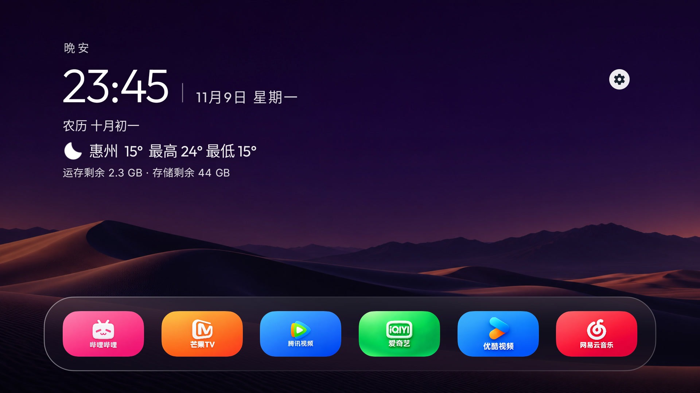

# HaloTV 3.0.1

An unofficial derivative of [Aerial](https://github.com/pengchujin/aerial-tv), maintained by Null_. Free to download and use; retains upstream MIT license and copyright notices. No affiliation or endorsement by upstream, Apple or television vendors.

[Website](https://halo-tv.pages.dev/) · [Downloads](https://github.com/Null9797/halo-tv/releases/latest) · [Quark mirror](https://pan.quark.cn/s/a14e3ab2dd41) · [Installation guide](INSTALL.md)

Standard and Guard require Android 5.0+ (versionCode 181); choose one. Lite supports Android 4.0+ (versionCode 39), without video wallpapers or the full performance modes. All display version 3.0.1. New control center, categorized settings, customizable Dock and information layouts, flip clock, child quiz and elder modes, phone management and validated HaloTV-only update uploads.

2.1.4 full builds detect the latest stable GitHub Release and can upgrade with the existing signing identity. Older Lite builds without an update checker need one manual upgrade. 3.0 checks the website first and falls back to GitHub; downloads do not silently install.

[Source archive](https://github.com/Null9797/halo-tv/releases/download/v3.0.1-halo-r2/HaloTV-3.0.1-source.zip) · [Checksums](SHA256SUMS.txt) · [Release notes](RELEASE_NOTES.md). Automated tests passed (273 per full flavor, 37 Lite); this does not certify every television firmware or codec. See [Chinese README](README.md) for features and screenshots.

Static imagery: Bing; archive by [YanGN](https://github.com/ygnstudio/bing_wallpaper_archive). Video catalogue references [Aerial Views](https://github.com/theothernt/AerialViews), videos from Apple. Media rights remain with their respective owners.

### Latest 3.0.1 rebuild
Full build 181 / Lite build 39: hide the empty announcements entry, skip unnecessary notice refreshes and reuse the desktop rendering layer beneath Control Center. 583 automated test executions passed; the rebuilt packages still require device validation.
