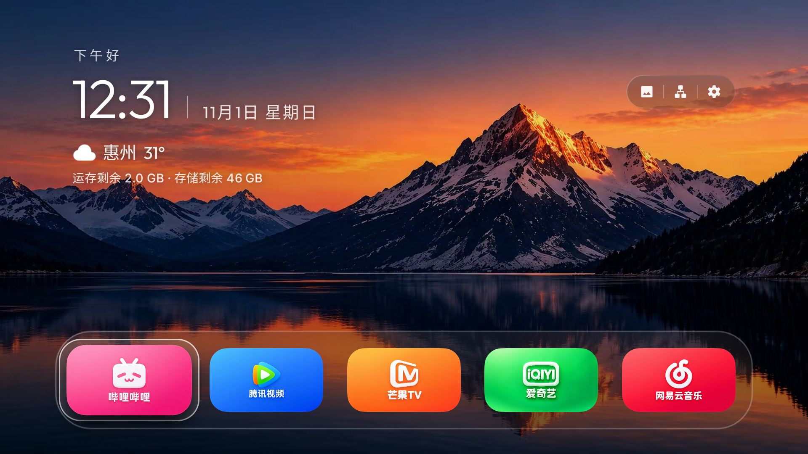

# Halo TV 2.0.3

> Halo TV 基于 [pengchujin/aerial-tv](https://github.com/pengchujin/aerial-tv) 开源项目二次开发，由 Null_ 整理和发布；不是 Aerial 原作者作品或官方发行版，与上游作者、Apple 及电视厂商没有隶属或背书关系。感谢 Aerial 原作者和所有贡献者。项目免费分享。

## Halo TV 2.0 实机效果

截图为上一版 2.0 的 TCL Q10G Pro 实机效果；2.0.3 新布局尚未实机验证。截图中的应用图标和天气由设备个性化设置决定。其他设备外观与功能会受分辨率、Android 版本和厂商固件影响。

## 下载与版本选择

在 [Releases](https://github.com/Null9797/halo-tv/releases/latest) 下载 2.0.3 安装包，安装后版本显示为 2.0.3。

| 版本 | 下载 | 适用系统与情况 |
|---|---|---|
| Standard | [HaloTV-2.0.3-standard.apk](https://github.com/Null9797/halo-tv/releases/download/v2.0.3-halo/HaloTV-2.0.3-standard.apk) | Android 5.0 及以上，系统允许第三方桌面时优先使用。 |
| Guard | [HaloTV-2.0.3-guard.apk](https://github.com/Null9797/halo-tv/releases/download/v2.0.3-halo/HaloTV-2.0.3-guard.apk) | Android 5.0 及以上；部分固件拦截桌面安装时可尝试，按应用引导自愿设置守护权限。 |
| Lite | [HaloTV-2.0.3-lite.apk](https://github.com/Null9797/halo-tv/releases/download/v2.0.3-halo/HaloTV-2.0.3-lite.apk) | Android 4.0–4.4 使用的轻量版；Android 4.x 真机尚未验证。 |

Standard 与 Guard 使用同一包名，每台设备安装其中一个。Lite 使用独立包名，功能和设置页面与完整版有差异。请先保留电视原有桌面。版本和校验信息见 [SHA256SUMS.txt](SHA256SUMS.txt)。

为了兼容旧版 Halo TV 的电视端更新器，Release 同时提供 `aerial-universal-2.0.3-standard.apk` 和 `aerial-universal-2.0.3-guard.apk`，它们与对应的 HaloTV 命名安装包内容完全相同。

## 2.0.3 更新内容

- 合入 Aerial 1.78 与 Aerial Lite 1.14 的相关设备兼容修复，包括信号源、开机守护和视频壁纸处理。
- 完整版右上角精简为设置按钮；控制中心提供壁纸与屏保入口、后台清理和调整后的并排布局。清理数量为请求数，可用内存变化为系统整体估算；Android 14 及以上不支持此清理方式。
- 新增农历日期开关；完整版设置图标可调整位置并选择常驻或淡出，控制中心位置保持固定。
- Lite 优化天气设置、桌面及控制中心排版，新增支持作者和项目声明入口。
- 调整屏保与桌面元素的显示，优化设置分类的遥控焦点操作。
- Halo TV 2.0 带来首次使用引导。
- 首页新增液态玻璃 Dock 和液态玻璃滑动焦点，保留磨砂玻璃等选择。新安装默认单排、每排五个应用、第二排不露出、仅显示选中应用名称。
- 时钟栏支持左上、右上、居中及状态栏位置，并可调整整组字号、天气和桌面文字颜色。可选择显示可用运存与存储。
- 重排控制中心与全屏分类设置页，集中桌面文字颜色、性能模式、音量和亮度等功能，并提供效果预览。
- 性能模式提供流畅优先、均衡和效果优先。静态壁纸、动态壁纸与屏保分类展示，提供翻页时钟屏保。
- 新安装默认翻页时钟、5 分钟进入屏保；已有用户设置会保留。Guard 的桌面守护需按引导明确授权。
- Lite 版针对 Android 4.x 保持精简，并提供照片、时钟和翻页时钟屏保；其界面与功能范围不同于完整版。

详细变更和已知限制见 [RELEASE_NOTES.md](RELEASE_NOTES.md)。

## 安装与使用

完整的 U 盘、ADB、AI 协助安装步骤，以及常见品牌开启 ADB 的入口见 [安装指南](INSTALL.md)。

1. 根据电视 Android 版本和厂商限制选择安装包。Standard 建议优先尝试。
2. 下载对应 APK，通过 U 盘或同一局域网中的 ADB 安装，并按电视提示确认。
3. Standard 可在系统默认桌面中选择 Halo TV；Guard 按应用说明自愿开启所需守护权限。如需切换桌面，请在系统设置中选择默认桌面，并按需在无障碍设置中关闭相关服务。

电视端更新会检查本仓库的正式 Release，更新提示和下载取决于电视对 GitHub 的网络访问；下载后仍需系统安装确认。Lite 是否有自动更新能力以实际版本为准，建议到 Release 页面手动下载。若下载失败，可在电脑或手机打开 Release 页面下载后使用 U 盘安装。

## 设备兼容

- 此前在 TCL Q10G Pro 上测试过 2.0；2.0.3 尚未进行电视实机回归，Lite 也尚未在 Android 4.x 真机验证。
- 上游 Aerial 的机型记录可供参考，并不代表 Halo TV 已在各型号逐一验证。厂商固件可能限制第三方桌面、守护和屏保。
- Samsung Tizen、LG webOS 和非 Android 的 VIDAA 不能安装 Android APK。Android 4.0–4.4 可尝试 Lite，兼容性以实际设备为准。
- 不建议关闭系统安全保护、删除系统桌面或尝试不熟悉的工程菜单。常见问题见 [FAQ.md](FAQ.md)。

## 源码与许可

- Halo TV 2.0.3 对应源码：[HaloTV-2.0.3-source.zip](https://github.com/Null9797/halo-tv/releases/download/v2.0.3-halo/HaloTV-2.0.3-source.zip)。
- 上游：[Aerial](https://github.com/pengchujin/aerial-tv)，保留 [MIT 许可](LICENSE)与原作者版权声明。
- 第三方字体、图标、壁纸、视频和天气数据受各自许可约束；品牌名称归各自权利人所有。项目与相关品牌没有隶属或背书关系。
