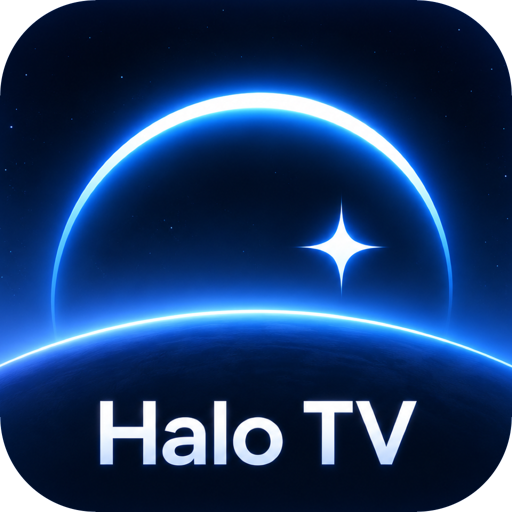
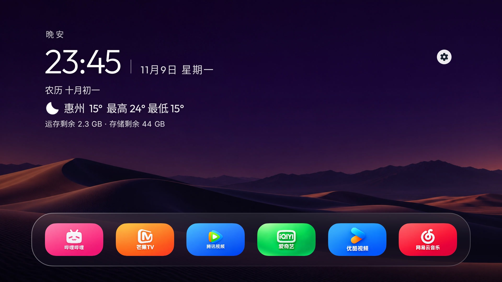
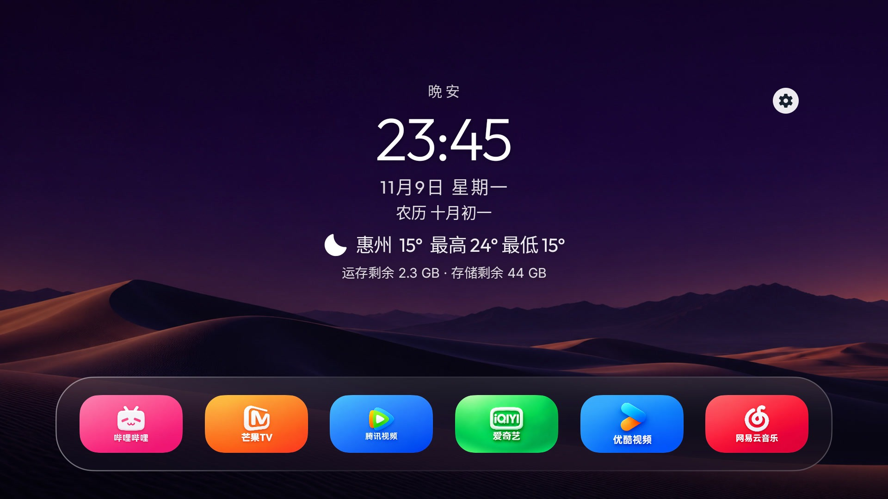
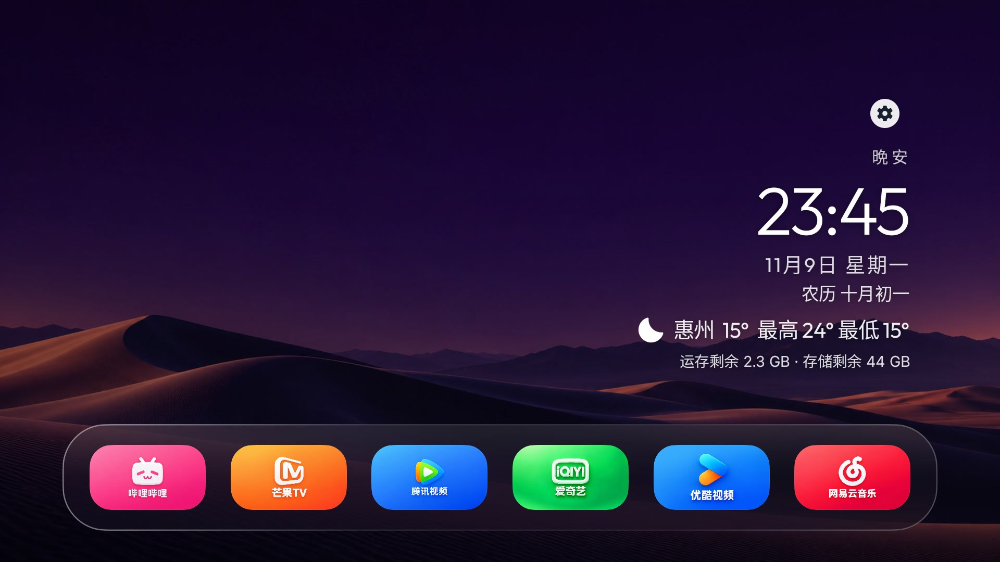
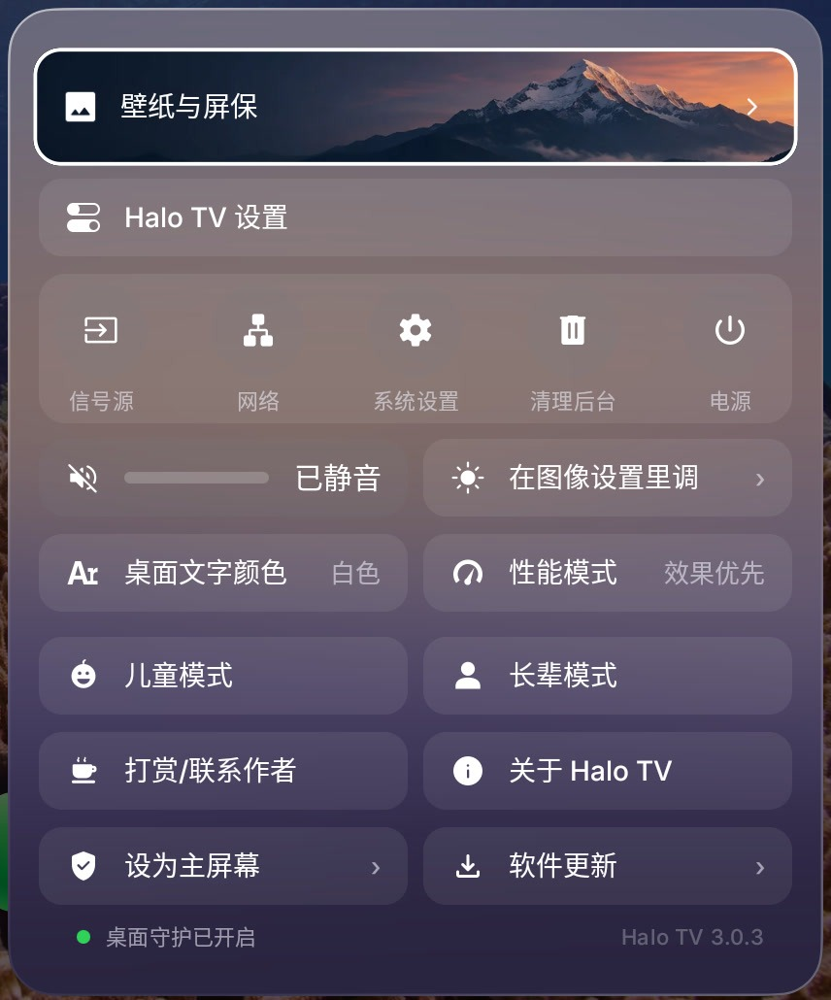
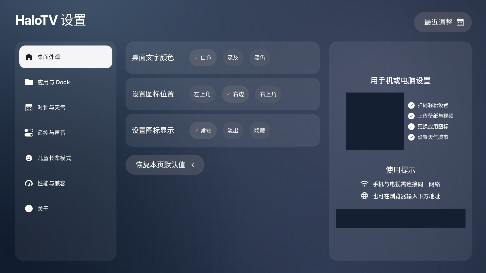
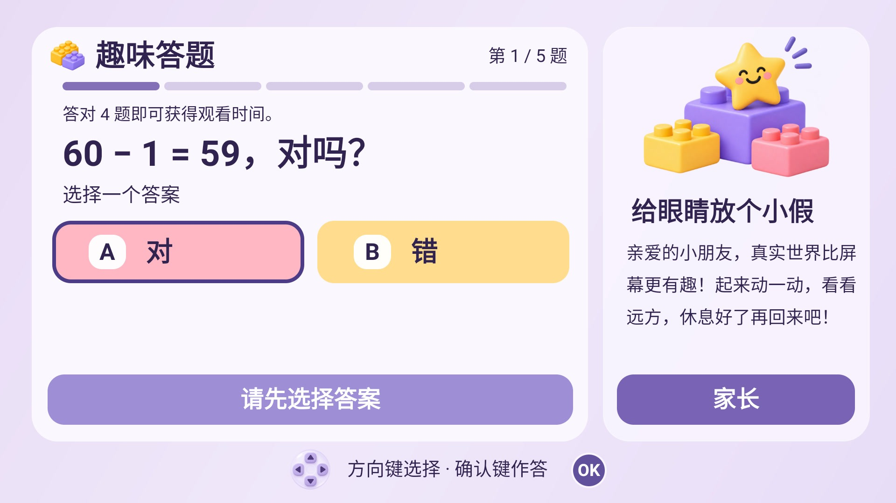
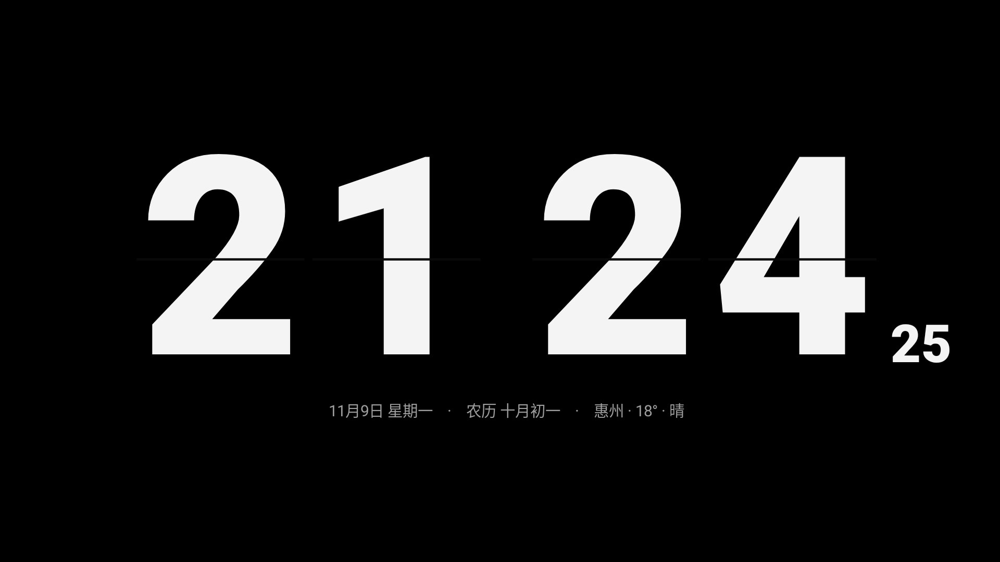
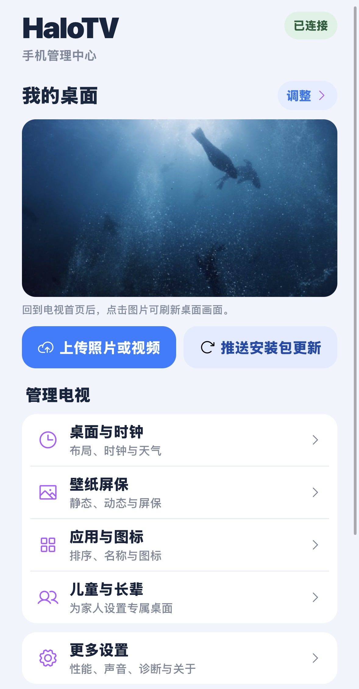

<h1 align="center">HaloTV 3.0.4</h1>

让电视桌面，回到你喜欢的样子。

<a href="https://halo-tv.pages.dev/">官方网站</a> · <a href="https://github.com/Null9797/halo-tv/releases/latest">下载最新版</a> · <a href="https://pan.quark.cn/s/a14e3ab2dd41">夸克网盘</a> · <a href="INSTALL.md">安装教程</a>

HaloTV 基于 [Aerial](https://github.com/pengchujin/aerial-tv) 开源项目二次开发，由 **Null_** 整理和发布，**不是 Aerial 原作者作品或官方发行版**。项目免费使用，保留上游 MIT 许可与版权声明；与 Apple、电视厂商及上游作者无隶属或背书关系。

## 3.0.4 已正式推出

全新的桌面、控制中心、分类设置、儿童答题与手机管理体验。正式版内部号 **185**，Lite 内部号 **41**。

## 3.0.4 更新摘要

整合 Aerial 1.94，保留此前 HaloTV 3.0 功能。本次正式版优化外部应用返回动态壁纸的首帧衔接与本地播放器复用，并修复手动清理被全局音频/VPN 判断错误拦截的问题。自动清理保持保守保护策略。正式版内部号 **185**，Lite **41**；Lite 本轮仅同步版本与更新信息。605 项自动测试执行通过；修复代码已在 TCL Android 11 测试包上验证，具体切换和清理能力仍受固件影响。

## 下载与选择

| 版本 | 官网直接下载 | GitHub | 适用情况 |
| --- | --- | --- | --- |
| Standard | [HaloTV-3.0.4-standard.apk](https://halo-tv.pages.dev/updates/HaloTV-3.0.4-standard.apk) | [备用下载](https://github.com/Null9797/halo-tv/releases/download/v3.0.4-halo/HaloTV-3.0.4-standard.apk) | Android 5.0+，建议优先尝试，标准 HOME 桌面入口 |
| Guard | [HaloTV-3.0.4-guard.apk](https://halo-tv.pages.dev/updates/HaloTV-3.0.4-guard.apk) | [备用下载](https://github.com/Null9797/halo-tv/releases/download/v3.0.4-halo/HaloTV-3.0.4-guard.apk) | Android 5.0+，部分限制第三方桌面的固件可尝试，按引导授权守护 |
| Lite | [HaloTV-3.0.4-lite.apk](https://halo-tv.pages.dev/updates/HaloTV-3.0.4-lite.apk) | [备用下载](https://github.com/Null9797/halo-tv/releases/download/v3.0.4-halo/HaloTV-3.0.4-lite.apk) | Android 4.0+ 轻量实现，面向 Android 4.0–4.4 老电视 |

Standard 与 Guard 同包名，每台电视选择其中一种；Lite 独立包名。网盘：[https://pan.quark.cn/s/a14e3ab2dd41](https://pan.quark.cn/s/a14e3ab2dd41)。校验见 [SHA256SUMS.txt](SHA256SUMS.txt)。

**从 2.1.4 升级：**正式版会从本仓库最新正式 Release 识别 3.0.4，保持原签名与包名，可以覆盖升级保留数据。2.1.4 Lite 没有在线检查入口，需要手动升级一次。3.0 起正式版与 Lite 均优先使用官网更新清单和 APK，GitHub 作为备用；自动下载默认关闭，安装由用户确认。

## 功能亮点

- **个性桌面：**单/双排、自定义应用排序与图标、磨砂/液态玻璃 Dock，大/小圆弧联动图标，滑动焦点。
- **信息随心：**左上、右上、居中、状态栏；问候语、时间日期、农历、天气最高/最低温度、运行信息开关与文字颜色，桌面 12/24 小时。
- **遥控更顺手：**新控制中心、分类设置、设置入口位置和常驻/淡出/隐藏；系统设置、信号源、网络、电源等入口。
- **壁纸与屏保：**在线静态壁纸、本地照片；正式版另有在线/本地视频动态桌面，支持自动轮换。在线内容只设置为壁纸，缓存用于运行，不提供另存本地按钮。
- **翻页时钟：**农历、12/24 小时、可选秒钟、防烧屏位移、闲置时间选择；本地素材可轮播或指定单个。
- **儿童与长辈：**应用白名单、儿童观看限额与答题获得时间、最晚观看时间；长辈大图标与休息提醒，密码和手动退出状态保存。
- **手机互联：**同网扫码设置、上传照片/视频、更换图标、推送 HaloTV 更新包；不会接收其他软件安装包。
- **性能与维护：**正式版流畅/均衡/效果优先；手动与可选空闲清理后台，实际能力由 Android 系统决定。

Lite 不含正式版动态视频桌面、在线视频库和性能模式；屏保类型、系统守护能力也依版本与固件而异。

## 3.0 实机细节

### 居中时钟与天气

### 靠右信息栏

### 控制中心

### 分类设置

### 儿童趣味答题

### 翻页时钟屏保

### 手机管理中心

截图来自 3.0 系列实机采集，部分保留测试阶段编号；最终包显示 3.0.4。界面与图标取决于用户设置，局域网二维码和地址已遮挡。

## 安装与使用

详见 [安装指南](INSTALL.md)，包含 U 盘、ADB、AI 协助安装和常见品牌调试入口。不要删除系统桌面。使用同包名、同签名新包覆盖安装可保留设置；配置守护前按电视提示确认授权用途。

## 兼容与验证

Standard / Guard 适用于 Android 5.0+，Lite 最低 Android 4.0。TCL Q10G Pro 是本项目实机采集设备；上游机型经验见 [Aerial 设备记录](https://github.com/pengchujin/aerial-tv#兼容性)。上游记录不等于 HaloTV 已逐台验证。Samsung Tizen、LG webOS 和非 Android VIDAA 无法安装 Android APK。

此次三个 Release 构建、签名与对齐检查通过，正式版各 284 项、Lite 37 项自动测试通过；不同厂商固件、视频编码、网络与跨日守护仍需实际设备验证。常见问题见 [FAQ](FAQ.md)。

## 来源、致谢与源码

- 本轮代码合并基线 Aerial 1.94：[pengchujin/aerial-tv](https://github.com/pengchujin/aerial-tv)。保留 [MIT 许可](LICENSE) 和 [来源声明](NOTICE.md)。
- 静态壁纸来自 Bing；归档由 **YanGN** 提供：[ygnstudio/bing_wallpaper_archive](https://github.com/ygnstudio/bing_wallpaper_archive)。图片版权归各权利人所有。
- 在线视频/缩略图目录参考 [Aerial Views](https://github.com/theothernt/AerialViews)；视频来自 Apple，内容权利归各权利人所有，代码许可不等于素材授权。
- [3.0.4 对应完整源码](https://github.com/Null9797/halo-tv/releases/download/v3.0.4-halo/HaloTV-3.0.4-source.zip)，包含正式版、Lite、资源及构建配置。构建需要自己的 Android SDK 与签名配置，签名密钥不公开。

感谢 Aerial 原作者、YanGN、开源贡献者与首批提供反馈的用户。更多变更见 [RELEASE_NOTES.md](RELEASE_NOTES.md)。
