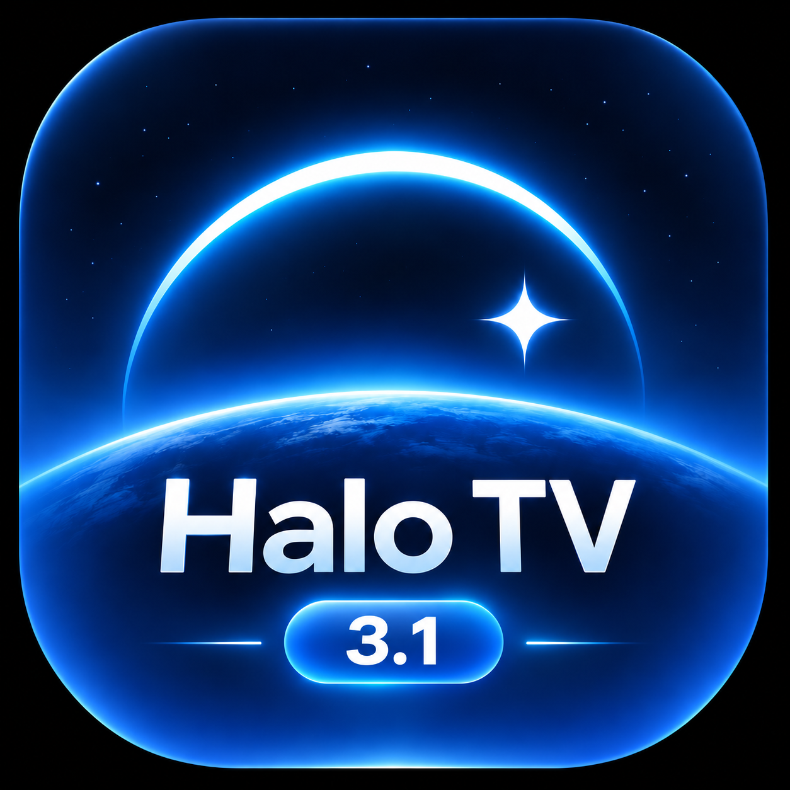

<h1 align="center">HaloTV 3.1.1</h1>

让电视桌面，回到你喜欢的样子。

<a href="https://halo-tv.pages.dev/">官方网站</a> · <a href="https://github.com/Null9797/halo-tv/releases/latest">下载最新版本</a> · <a href="INSTALL.md">安装教程</a> · <a href="FAQ.md">常见问题</a>

**HaloTV 基于 [Aerial](https://github.com/pengchujin/aerial-tv) 二次开发，由 Null_ 整理发布，非 Aerial 原作者或官方发行版。感谢原作者和所有开源贡献者。保留原版权与 MIT 许可，免费分享。**

## 3.1.1 更新

改进手机天气设置、壁纸切换焦点、本地视频切换和在线视频播放恢复。减少播放时额外解码与反复取帧；自动画质遇到持续严重掉帧可回退至 1080p。

默认设置为：设置图标淡出、农历开启、经典玻璃滑动焦点、空闲自动清理开启、柔和按键音。已保存的设置不强制覆盖。

三个安装包均为新包名与专属签名，显示版本 **3.1.1**；Standard / Guard 内部号 **195**，Lite **51**。可覆盖升级 3.1 独立版。文件名不再带 independent。 [详细更新与验证范围](RELEASE_NOTES.md)

## 3.1.1 与旧版迁移

旧用户请先覆盖安装同类型过渡版，再安装、导入并配置独立版；新用户建议直接使用独立版。独立版使用新包名和专属签名，可与 Aerial 共存，后续更新将面向独立版提供。

**先迁移，后卸载旧版。独立版必须重新设置默认桌面、屏保与桌面守护权限。** [完整迁移说明](MIGRATION-3.1.md)

| 类型 | 独立版（新用户/迁移目标） | 过渡版（旧用户先安装） | 适用范围 |
|---|---|---|---|
| Standard | [官网](https://halo-tv.pages.dev/updates/HaloTV-3.1.1-standard.apk) · [GitHub](https://github.com/Null9797/halo-tv/releases/download/v3.1.1-halo/HaloTV-3.1.1-standard.apk) | [官网](https://halo-tv.pages.dev/updates/HaloTV-3.1-standard.apk) · [GitHub](https://github.com/Null9797/halo-tv/releases/download/v3.1-halo/HaloTV-3.1-standard.apk) | Android 5.0+，优先尝试 |
| Guard | [官网](https://halo-tv.pages.dev/updates/HaloTV-3.1.1-guard.apk) · [GitHub](https://github.com/Null9797/halo-tv/releases/download/v3.1.1-halo/HaloTV-3.1.1-guard.apk) | [官网](https://halo-tv.pages.dev/updates/HaloTV-3.1-guard.apk) · [GitHub](https://github.com/Null9797/halo-tv/releases/download/v3.1-halo/HaloTV-3.1-guard.apk) | Android 5.0+，限制第三方 HOME 的固件可尝试 |
| Lite | [官网](https://halo-tv.pages.dev/updates/HaloTV-3.1.1-lite.apk) · [GitHub](https://github.com/Null9797/halo-tv/releases/download/v3.1.1-halo/HaloTV-3.1.1-lite.apk) | [官网](https://halo-tv.pages.dev/updates/HaloTV-3.1-lite.apk) · [GitHub](https://github.com/Null9797/halo-tv/releases/download/v3.1-halo/HaloTV-3.1-lite.apk) | Android 4.0+，面向老设备，不含正式版动态桌面 |

同一发行方式的 Standard/Guard 共用包名，二选一；迁移时保持类型一致。旧版不能把新包名当作覆盖更新，过渡版为此增加了独立安装入口与严格的手机推送校验。旧包名用户请从 [3.1 历史发布](https://github.com/Null9797/halo-tv/releases/tag/v3.1-halo) 选择对应过渡版；旧更新清单保持指向过渡版；旧 Lite 没有更新入口时需手动安装过渡版一次。

## 3.1 更新亮点

- 独立 Logo、独立包名与签名，新增设置/素材导入与旧守护交接。
- 经典玻璃滑动焦点、Dock 上方选中名称、翻页时钟数字秒钟/跳动冒号。
- 关于页紧凑布局，展示开源、官网与网盘地址；清晰标明 Standard/Guard/Lite 及发行方式。
- 延续玻璃 Dock、自定义图标、信息栏、壁纸屏保、儿童长辈模式、手机管理与在线更新。

## 界面展示

3.0 系列实机素材展示已有功能；部分图片保留采集时的版本编号，3.1 独立版图标与身份信息以最终安装包为准。

## 安装与使用

[安装教程](INSTALL.md) · [3.1 迁移指南](MIGRATION-3.1.md) · [常见问题](FAQ.md) · [更新说明](RELEASE_NOTES.md)

厂商固件对安装、默认桌面、开机启动和无障碍守护的限制存在差异，不能保证所有电视零闪烁或守护永久有效。不要同时开启多个桌面的守护。卸载旧 HaloTV 前请在独立版确认设置与素材已迁移、Home 和日常使用正常。

## 开源与来源

- 基于 [pengchujin/aerial-tv](https://github.com/pengchujin/aerial-tv)；感谢 Aerial 原作者，保留 [LICENSE](LICENSE) 与 [NOTICE](NOTICE.md)。
- Bing 壁纸归档由 [YanGN](https://github.com/ygnstudio/bing_wallpaper_archive) 提供。
- 在线视频目录参考 [Aerial Views](https://github.com/theothernt/AerialViews)，视频来自 Apple，素材版权归各权利人；代码许可不代替素材授权，与上述主体无隶属或背书关系。
- [3.1.1 三个安装包对应完整源码](https://github.com/Null9797/halo-tv/releases/download/v3.1.1-halo/HaloTV-3.1.1-source.zip)。私钥不公开。

[官方网站](https://halo-tv.pages.dev/) · [网盘](https://pan.quark.cn/s/a14e3ab2dd41)（实际内容以网盘为准）
