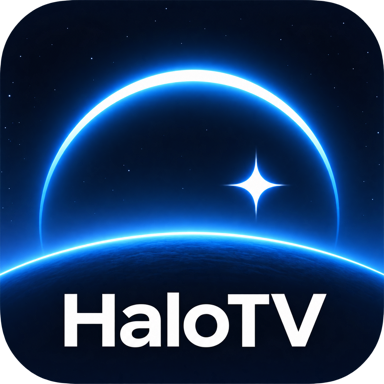
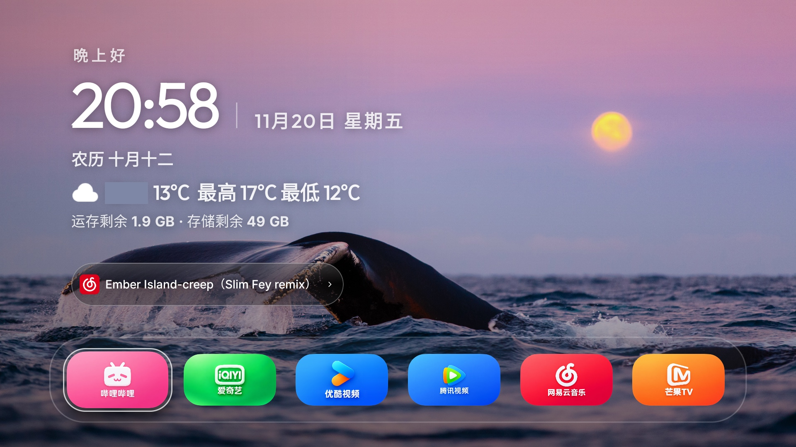

  
  <h1>HaloTV</h1>
  
<strong>Your TV, your home screen.</strong>

  
Free, open-source launcher for Android TV · Release 3.5.2

  
<a href="https://halo-tv.pages.dev/">Website</a> · <a href="../README.md">简体中文</a> · <a href="../INSTALL.md">Installation guide</a> · <a href="https://github.com/Null9797/halo-tv/issues">Issues</a>

HaloTV is a community-maintained derivative of [Aerial](https://github.com/pengchujin/aerial-tv), published by Null_. Thanks to the original author and contributors. HaloTV retains the original copyright and [MIT license](../LICENSE).

## Download and install

| Edition | Use case | Website | GitHub |
| --- | --- | --- | --- |
| **Standard** | Android 5.0+; try this first | [APK](https://halo-tv.pages.dev/updates/HaloTV-3.5.2-standard.apk) | [APK](https://github.com/Null9797/halo-tv/releases/download/v3.5.2-halo/HaloTV-3.5.2-standard.apk) |
| **Guard** | Android 5.0+; try it on firmware that restricts third-party launchers | [APK](https://halo-tv.pages.dev/updates/HaloTV-3.5.2-guard.apk) | [APK](https://github.com/Null9797/halo-tv/releases/download/v3.5.2-halo/HaloTV-3.5.2-guard.apk) |
| **Lite** | Android 4.0+; designed for older or lower-powered TVs | [APK](https://halo-tv.pages.dev/updates/HaloTV-3.5.2-lite.apk) | [APK](https://github.com/Null9797/halo-tv/releases/download/v3.5.2-halo/HaloTV-3.5.2-lite.apk) |

Install the matching edition over an existing independent installation to retain its settings. Aerial and independent HaloTV can coexist with separate permissions and data. Use only one desktop guard at a time. Cross-package configuration import was removed in 3.2.4.

[Website downloads](https://halo-tv.pages.dev/#download) · [Release 3.5.2](https://github.com/Null9797/halo-tv/releases/tag/v3.5.2-halo) · [Application source](https://github.com/Null9797/halo-tv/releases/download/v3.5.2-halo/HaloTV-3.5.2-source.zip)

## What's new in 3.5.2

- Improved the first-frame handoff for local video wallpaper on Android 5/6. [#58](https://github.com/Null9797/halo-tv/issues/58)
- Added an optional 4K SDR trial on eligible Android 5/6 devices, with 1080p fallback. [#55](https://github.com/Null9797/halo-tv/issues/55)
- Standard and Guard can pause and resume supported media apps around the kids' quiz.
- All editions align the date, weekday and lunar date below the clock and use a versionless app icon.
- Lite adds an online photo screensaver, settings-icon placement and optional Home Guard on Android 5.0 and later.

Standard / Guard build 278; Lite build 125. Upgrade using the same edition.

[TV screenshots](GALLERY.md) · [Release notes](releases/RELEASE-3.5.2.md) · [Build verification](releases/VERIFICATION-3.5.2.json)

Screenshot credit: HaloTV 3.5-series test build captured on a TV.

## Support and credits

Search [existing Issues](https://github.com/Null9797/halo-tv/issues) before [reporting a problem](https://github.com/Null9797/halo-tv/issues/new?template=bug_report.yml). Include the TV model, Android version, HaloTV version, edition and reproduction steps.

The Bing archive is provided by [YanGN](https://github.com/ygnstudio/bing_wallpaper_archive). The video catalogue references [Aerial Views](https://github.com/theothernt/AerialViews) with Apple-hosted media. Media rights remain with the respective owners. See [LICENSE](../LICENSE) and [NOTICE](NOTICE.md).
