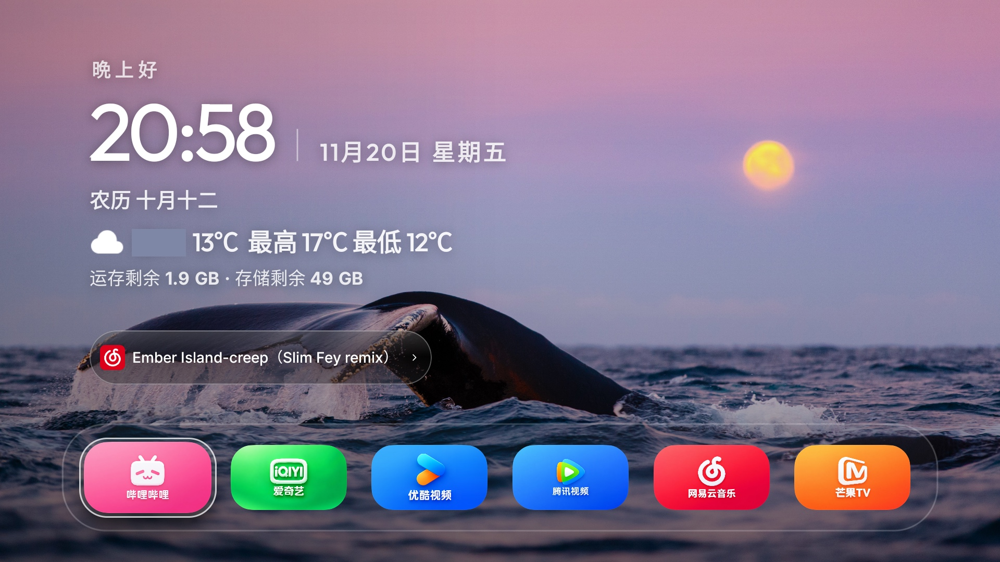
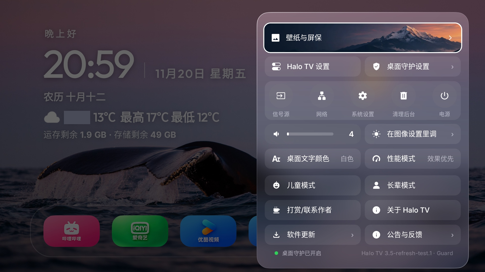
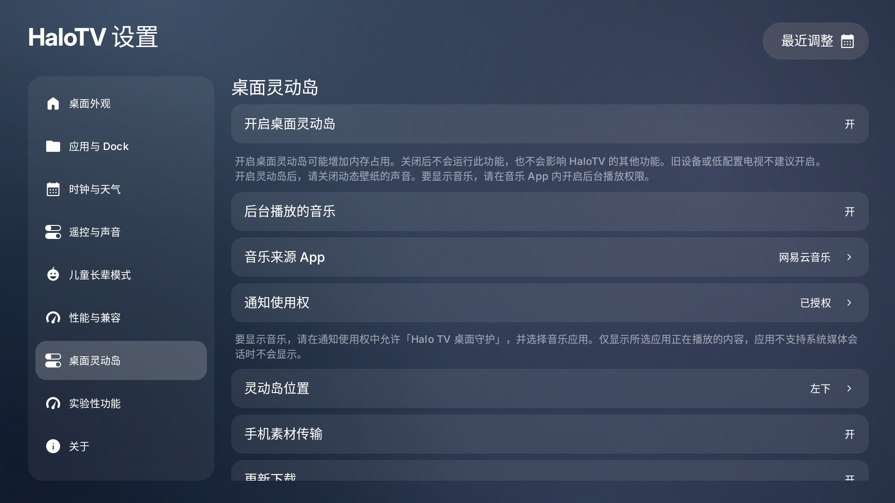
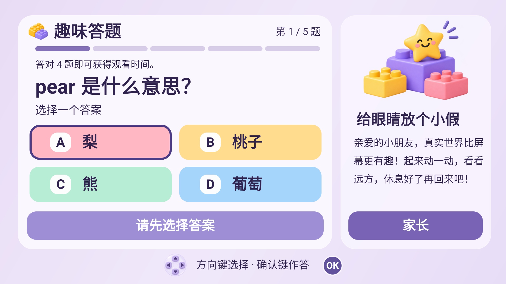
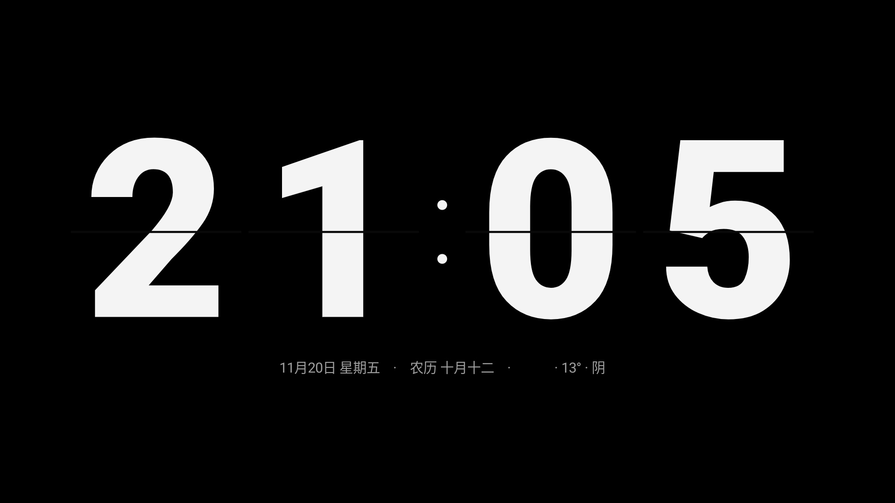
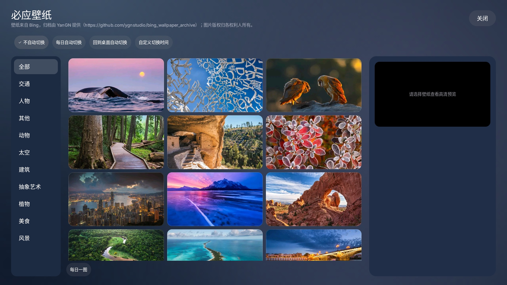
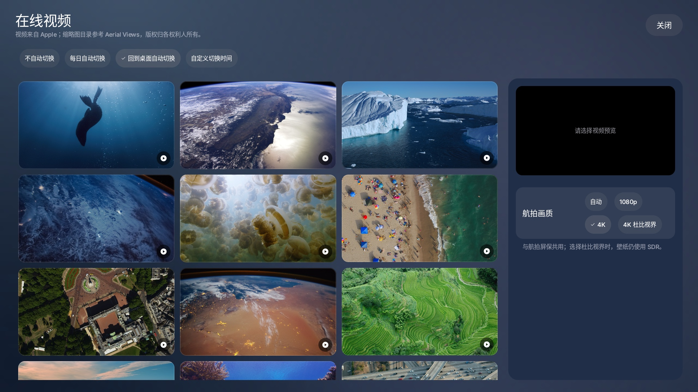

# HaloTV 实机画廊

[项目首页](../README.md) · [官网画廊](https://halo-tv.pages.dev/#showcase) · [下载](https://halo-tv.pages.dev/#download)

最新图集采集自 HaloTV 3.5 系列测试构建。原图为 1920 × 1080，点击可查看完整画面。

| 控制中心 | 桌面灵动岛设置 |
| :---: | :---: |
|  |  |
| **儿童模式 · 趣味答题** | **翻页时钟** |
|  |  |
| **在线静态壁纸库** | **在线动态壁纸库** |
|  |  |

此前的 3.5 Guard 截图

- [电视桌面与音乐灵动岛](../website/images/home-3.5.jpg)
- [桌面灵动岛设置](../website/images/island-settings-3.5.jpg)
- [毛玻璃控制中心](../website/images/control-3.5.jpg)
- [全部应用](../website/images/all-apps-3.5.jpg)
- [应用与 Dock](../website/images/dock-settings-3.5.jpg)
- [时钟与天气](../website/images/clock-settings-3.5.jpg)
- [壁纸与屏保](../website/images/wallpaper-3.5.jpg)
- [翻页时钟屏保](../website/images/flip-3.5.jpg)
- [儿童与长辈模式设置](../website/images/family-settings-3.5.jpg)
- [桌面守护设置](../website/images/guard-settings-3.5.jpg)
- [软件更新](../website/images/update-3.5.jpg)

