# HaloTV 3.5 实机截图

截自运行 HaloTV 3.5 Guard 的电视，保留 1920 × 1080。局域网地址与二维码已遮挡。应用图标和背景取决于设备设置。

[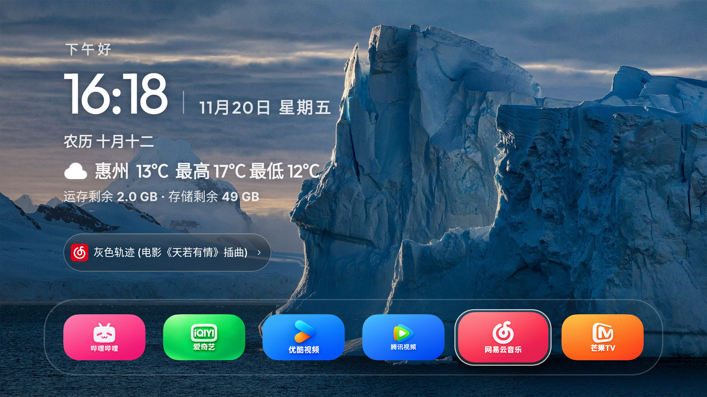](../website/images/home-3.5.jpg)

| 桌面灵动岛设置 | 毛玻璃控制中心 |
| --- | --- |
| [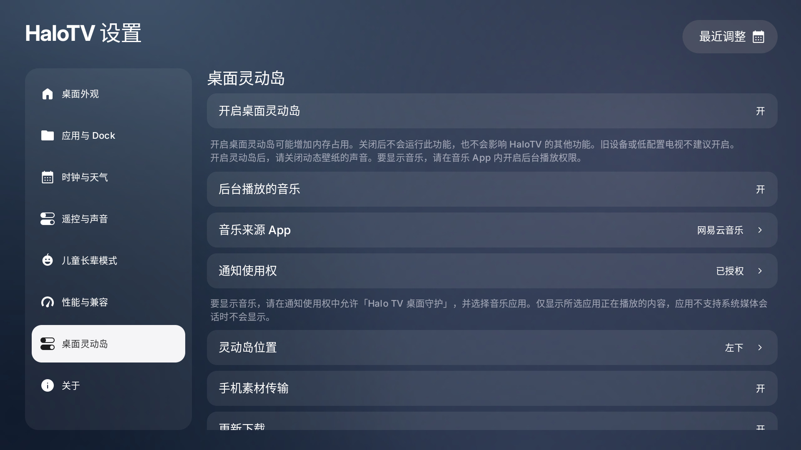](../website/images/island-settings-3.5.jpg) | [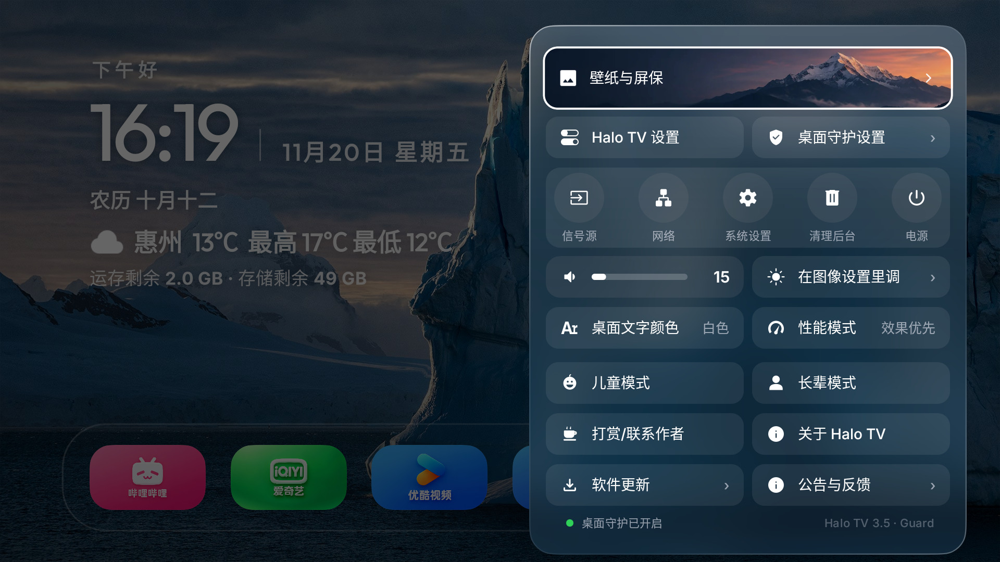](../website/images/control-3.5.jpg) |

| 全部应用 | 应用与 Dock |
| --- | --- |
| [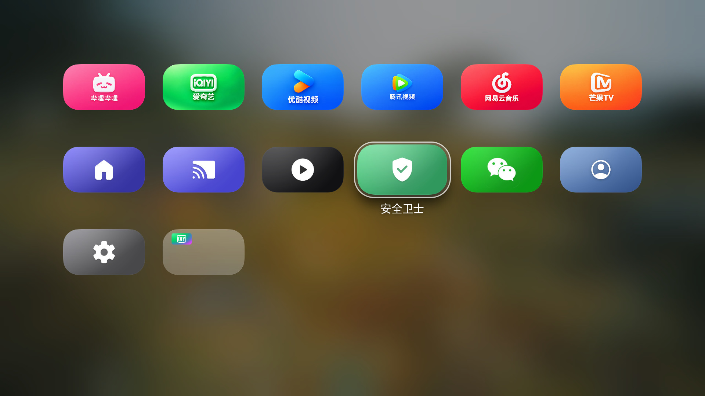](../website/images/all-apps-3.5.jpg) | [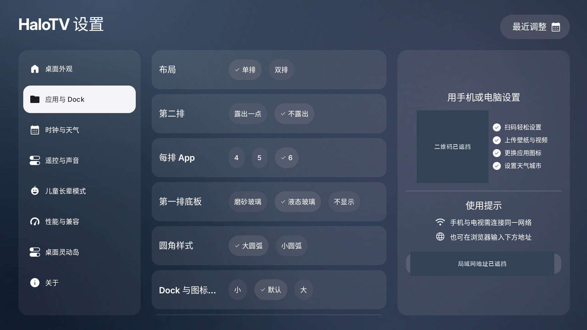](../website/images/dock-settings-3.5.jpg) |

| 时钟与天气 | 壁纸与屏保 |
| --- | --- |
| [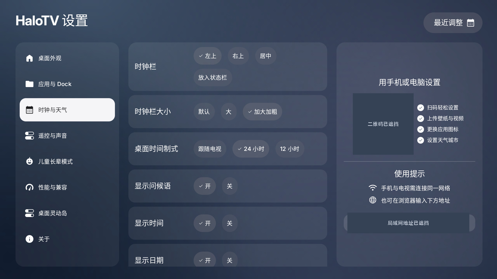](../website/images/clock-settings-3.5.jpg) | [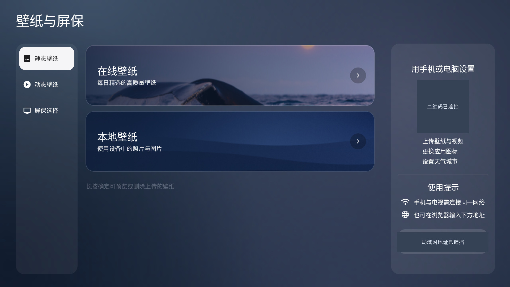](../website/images/wallpaper-3.5.jpg) |

| 翻页时钟屏保 | 儿童与长辈模式设置 |
| --- | --- |
| [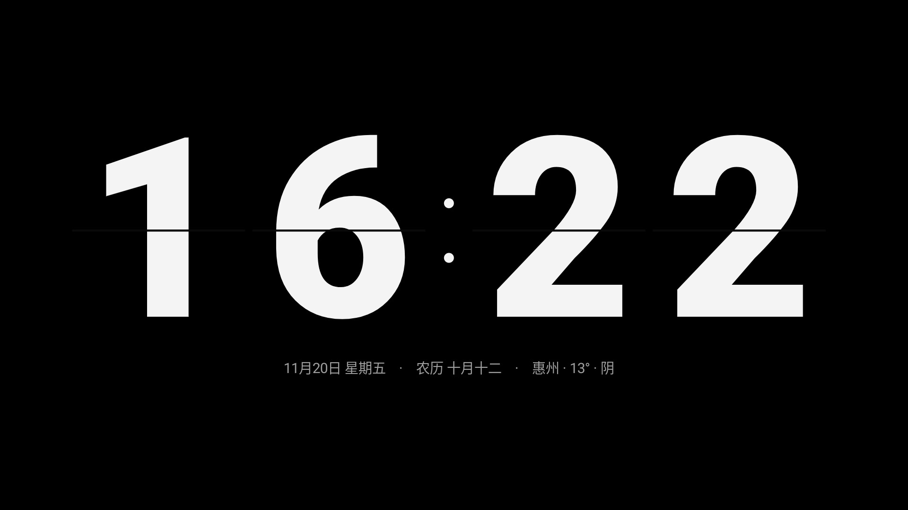](../website/images/flip-3.5.jpg) | [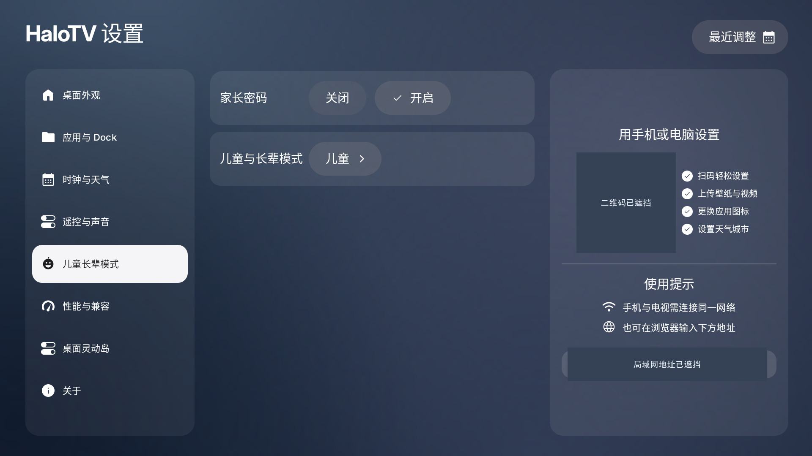](../website/images/family-settings-3.5.jpg) |

| 桌面守护设置 | 软件更新 |
| --- | --- |
| [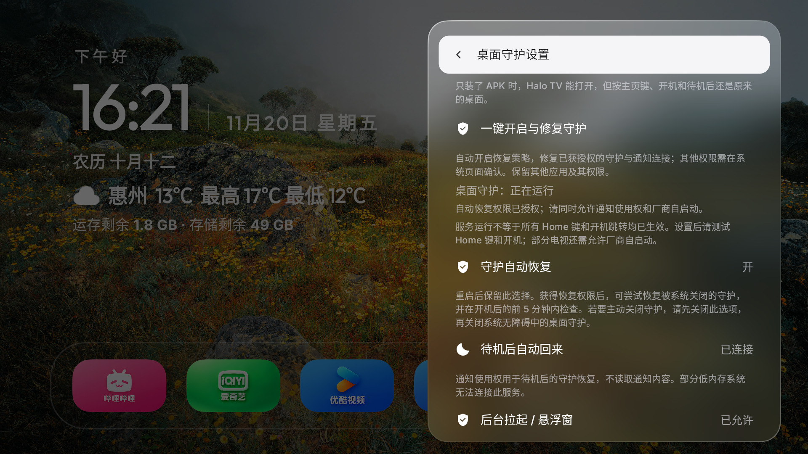](../website/images/guard-settings-3.5.jpg) | [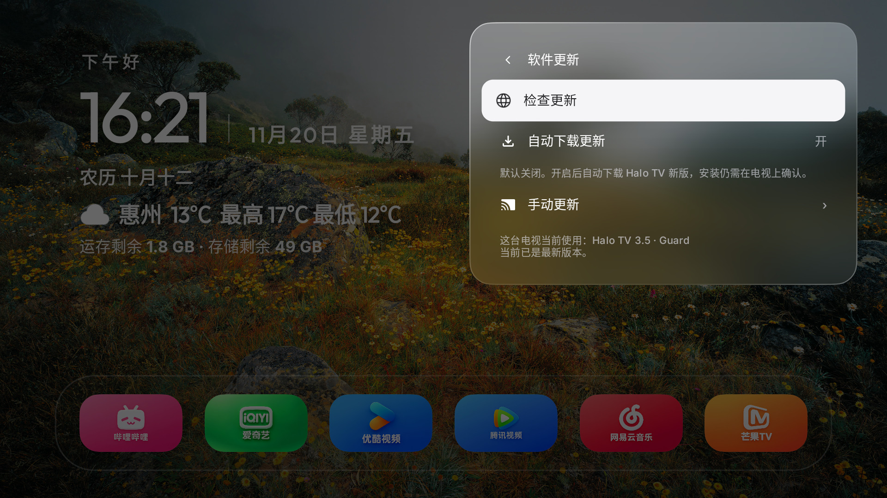](../website/images/update-3.5.jpg) |
